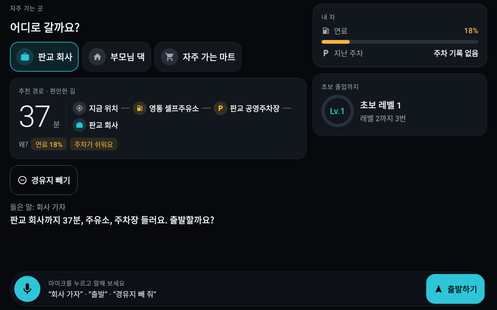
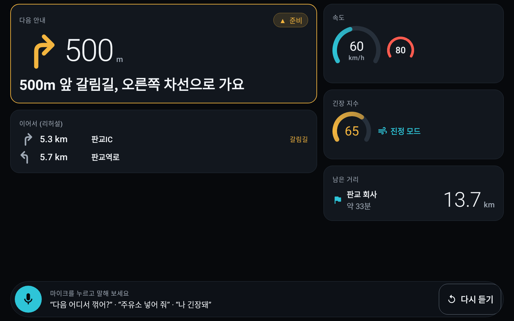
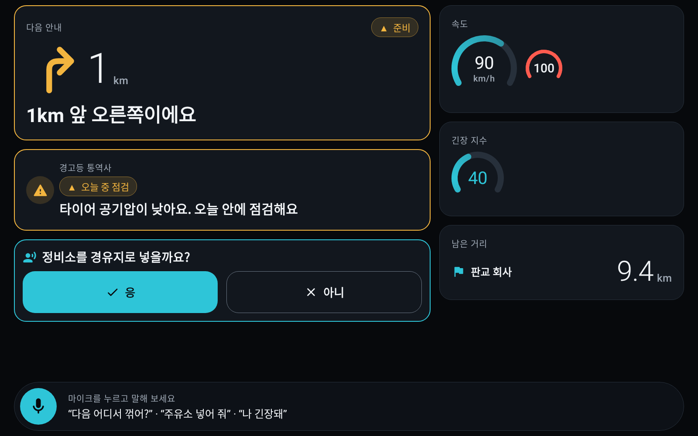
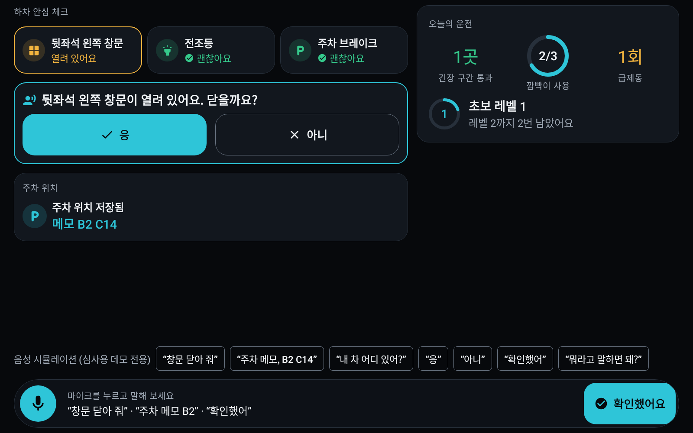
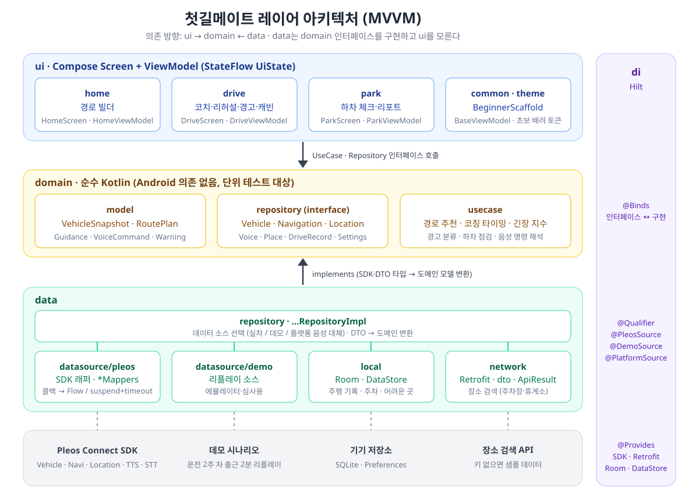

# 첫길메이트 (FirstRoad Mate)

> **초보 운전자를 위한 차량용 동승 앱.** 차량 신호를 읽고 차선 준비·깜빡이·경고등·하차 확인을 한 박자 먼저 말로 챙겨 주며, 운전이 익숙해지면 스스로 말수를 줄입니다.

Pleos Connect(Android Automotive OS 기반)용 Android 앱입니다. 휴대폰 앱은 운전자가 *어디에 있는지*만 알지만, 첫길메이트는 방향지시등·기어·창문·경고등·공조 같은 **차량 신호로 운전자가 *무엇을 했는지*를 확인**하고, 내비 경유지·창문·공조를 **차에서 직접 움직입니다.**

| 홈 · 경로 빌더 | 주행 · 다음 행동 카드 |
|---|---|
|  |  |
| **경고등 통역사** | **하차 안심 체크 · 오늘의 운전** |
|  |  |

## 제출 정보 한눈에

| 항목 | 내용 |
|---|---|
| 앱 이름 | 첫길메이트 (FirstRoad Mate), `com.firstroad.mate` |
| 한 줄 소개 | 차량 신호를 읽고 한 박자 먼저 말해 주다가, 익숙해지면 말수를 줄이는 초보 운전자 전용 동승 앱 |
| release APK | [`apk/FirstRoadMate_첫길메이트_release.apk`](apk/) |
| 시연 영상 | [`docs/video/demo_voice_only_1024x768.mp4`](docs/video/demo_voice_only_1024x768.mp4) (데모 출근길 전 구간을 기능 버튼 없이 음성 명령만으로 진행, 소리 없음) |
| 개발·검증 에뮬레이터 | Pleos Connect Emulator v2.1 기준 SDK 연동, Android Automotive 에뮬레이터 API 34 (automotive x86_64) |
| 화면 규격 | **1024×768** (가로, 자동차 디스플레이). 1200dp 이상이면 위젯 열을 펼치는 반응형 배치 |
| 최소 / 대상 SDK | minSdk 28 (Pleos Connect 요구사항) / targetSdk 36 |
| 테스트 | JVM 단위 테스트 **61개** (업무 규칙, 데모 시나리오 전 구간, 메시지 타이밍, 음성 흐름, 문장 길이, 화면 렌더링) |

---

## 1. 기술 하이라이트

### 1.1 주행 판단을 순수 함수 하나로: `DriveTickUseCase`

주행 중 모든 판단은 `(이전 상태, 이번 입력) → (새 상태, 이벤트 목록)` 형태의 순수 함수가 맡습니다. 입력(`DriveInput`)은 차량·내비·위치·메시지 신호를 한 시점으로 묶은 스냅숏이고, 출력은 말할 안내와 실행할 차량 제어 요청입니다.

```kotlin
operator fun invoke(previous: DriveSessionState, input: DriveInput): DriveTick {
    var state = previous
    val events = mutableListOf<DriveEvent>()
    state = brief(state, input, events)      // ③ 출발 브리핑 · 고속도로 리허설
    state = coach(state, input, events)      // ② 첫길 코치 (차선 준비 → 깜빡이 → 칭찬)
    state = hardBrake(state, input, events)
    state = speedLimit(state, input, events)
    state = warnings(state, input, events)   // ④ 경고등 통역사
    state = calmCabin(state, input, events)  // ⑤ 카밍 캐빈 (긴장 지수 → 공조)
    state = messages(state, input, events)   // ⑦ 메시지 타이밍 비서
    state = arrival(state, input, events)    // ⑥ 하차 안심 체크
    return DriveTick(state, events)
}
```

- Android·Pleos SDK 의존성이 없어서 **실차 없이 JVM에서 판단 로직 전체를 테스트**할 수 있습니다.
- 데모 모드와 실차 모드가 **같은 판단 코드**를 씁니다. 바뀌는 것은 입력을 만드는 데이터 소스뿐입니다.
- `DriveTickScenarioTest`가 2분짜리 데모 출근길을 틱 단위로 재생하며 모든 안내의 순서·시점을 확인합니다.

### 1.2 차량 신호 → Flow, 모르는 값은 추정하지 않는다

| 신호 | 출처 | 받는 방식 |
|---|---|---|
| 방향지시등, 브레이크, 연료, EV 배터리, 와이퍼, 전조등 | Pleos Vehicle SDK 2.3.2 | 구독 리스너 → `callbackFlow` |
| 경고등(Telltale), 창문 위치, 공조 | Pleos Vehicle SDK 2.3.2 | 구독에 비공개 권한이 필요한 항목은 코루틴 주기 조회(1초) |
| 차속, 기어 | AAOS `CarPropertyManager` | `PERF_VEHICLE_SPEED`, 기어 프로퍼티 구독 |
| 주행 중 화면 제한 | AAOS `CarUxRestrictionsManager` | 제한 상태 구독 → 주행 중 UI 축소 |
| 경로·회전·갈림길 | Pleos NaviHelper 3.0.5 | 경로 상태 구독, 경유지 추가 명령 |
| 위치 | Pleos FusedLocation 1.1.3 | 위치 업데이트 Flow |
| 음성 입·출력 | Pleos TextToSpeech / SpeechToText 3.3.1 | 없으면 Android 기본 TTS/STT로 대체 |
| 메시지 알림 | Android `NotificationListenerService` | 카카오톡·문자 알림만 파싱, 사용자 허용 시 |

- 연결 실패·권한 없음·SDK 예외는 모두 `null`(모름)로 내보내고, 해당 판단은 **건너뜁니다.** 초보에게는 틀린 안내가 안내가 없는 것보다 위험하기 때문입니다.
- 콜백 하나로 결과를 주는 SDK 호출은 `awaitSdkCallback`으로 `suspend` 함수로 바꾸고 3초 타임아웃을 둡니다. 콜백이 오지 않아도 코루틴이 멈추지 않습니다.
- Pleos SDK 객체는 Pleos가 아닌 일반 AAOS에서도 만들어지기 때문에, `PleosServiceProbe`가 **자동차 기기 여부 + `pleos.car.permission.*` 권한 정의 여부 + Vehicle Service 연결**을 모두 확인해서 실차/데모 모드를 자동으로 고릅니다.

### 1.3 거리가 아니라 *시간*으로 계산하는 코칭 타이밍

일반 내비의 "300m 앞 우회전"은 숙련자 기준이라 초보가 차선을 옮기기엔 늦습니다. `CoachTimingUseCase`는 현재 차속으로 회전까지 남은 **시간**을 계산합니다.

| 단계 | 기준 | 하는 일 |
|---|---|---|
| 준비 | 25초 전 또는 350m 전 중 먼저 오는 때 (고속도로 합류·분기는 1km 전) | "오른쪽 차선으로 가요" |
| 알림 | 7초 전 | 방향지시등이 꺼져 있으면 "오른쪽 깜빡이 켜요" |
| 판정 | 3초 전 | 실제 방향지시등 신호를 읽어 칭찬하고 사용률 기록 |

시속 5km 미만이거나 차속을 모르면 거리 기준(350m / 60m / 25m)으로 바꿔 판단합니다.

### 1.4 말해도 되는 순간만 말한다: 음성 에티켓과 우선순위

- **우선순위:** 회전 > 경고 > 대답 > 질문 > 코칭 > 칭찬. 높은 우선순위가 오면 `GuidanceSpeaker`가 말하던 것을 끊고, 확인 질문·중요 안내는 버리지 않고 대기열에 넣습니다.
- **에티켓 (`VoiceEtiquetteUseCase`):** 회전 4초 전부터는 회전 안내 외에는 말하지 않고, 일반 안내는 직전 안내와 8초 이상 떨어뜨립니다.
- **문장 길이:** 주행 중 25자, 그 밖 40자 이내. `PhraseLengthTest`가 모든 문장을 검사합니다.
- **메시지 타이밍 (`MessageTimingUseCase`):** 회전 준비 구간, 주의 지점 500m 앞, 긴장 지수 30 이상, 급제동 후 10초, 새 경고등, 목적지 500m 안에서는 알림을 보류합니다. 보류할 일이 없는 구간이 5초 이어지거나 정차(3km/h 미만)하면 한 번만 묻고, 같은 운전 중에는 60초 이상 간격을 둡니다.

### 1.5 긴장 지수와 카밍 캐빈

`TensionScoreUseCase`가 앞으로 짧은 시간 동안의 긴장도(0~100)를 계산합니다. 입력은 합류·급커브·사고 다발 구간(500m), 갈림길(800m), 회전(200m), 와이퍼, 전조등, 급제동입니다. 60 이상이면 **사전 동의한 운전자에 한해** 실내 온도 −1℃, 풍량 +1단으로 조절하고, 구간을 지나면 원래 값으로 되돌립니다.

### 1.6 규칙 기반 음성 명령

음성 명령 18종은 `ParseVoiceCommandUseCase`가 규칙으로 해석합니다. 네트워크 없이 동작하고, 같은 말에는 항상 같은 결과가 나와 테스트로 확인할 수 있습니다. 화면마다 다른 문맥(`VoiceContext`)을 넘겨서 "응"이 출발 확인인지, 창문 닫기 확인인지, 메시지 읽기 확인인지 구분합니다.

### 1.7 안전·권한 원칙

- 주행 중 화면은 카드 한 장과 버튼 두 개 (`CarUxRestrictions` 준수).
- 창문 제어는 **P단 + 운전자 음성 확인** 뒤에만, 공조 자동 변경은 **사전 동의(opt-in)** 시에만 합니다.
- 제어 권한이 없으면 "직접 확인해 주세요" 안내로 대체합니다.
- 메시지 내용은 메모리에만 두고 30분 뒤 지우며, 저장·전송하지 않습니다. 답장 기능은 없습니다.
- 주행 기록·주차 위치는 기기 안(Room)에만 저장합니다.
- 경고 안내는 차량 취급설명서를 대체하지 않습니다. 처음 보는 경고등은 보수적으로 '오늘 중 점검'으로 분류합니다.

---

## 2. 아키텍처



```
com.firstroad.mate
├── data/
│   ├── datasource/  vehicle · navi · location · voice · message · settings
│   │                 각각 pleos/ (실차) 와 demo/ (데모) 구현
│   ├── local/        Room (주행 기록, 주차 위치, 어려운 구간)
│   ├── network/      Retrofit + ApiResult CallAdapter (카카오 로컬 장소 검색)
│   └── repository/   Repository 구현
├── domain/
│   ├── model/        DriveInput, DriveSessionState, Guidance, VehicleWarning ...
│   ├── repository/   Repository 인터페이스
│   └── usecase/      순수 업무 규칙 14개 (DriveTick, CoachTiming, TensionScore, MessageTiming ...)
├── di/               Hilt 모듈 (DataSourceModule이 실차/데모 소스 선택)
└── ui/               Screen + ViewModel + UiState (home · drive · park), 음성 안내, 테마
```

- `ui → domain ← data` 단방향 의존. Pleos SDK 호출은 `data/datasource/**/pleos`에만 있습니다.
- 차량 신호를 읽는 부분(`VehicleDataSource`)과 판단 규칙(UseCase)이 나뉘어 있어서, 다른 Pleos Connect 차종으로 옮길 때는 데이터 소스만 바꾸면 됩니다.

| 구분 | 사용 |
|---|---|
| 언어·UI | Kotlin 2.3, Jetpack Compose, Material 3 |
| 아키텍처 | MVVM, Clean Architecture 레이어, Hilt |
| 비동기·저장 | Coroutines/Flow, Room, DataStore |
| 네트워크 | Retrofit, OkHttp, kotlinx.serialization |
| Pleos Connect SDK | Vehicle 2.3.2 · NaviHelper 3.0.5 · FusedLocation 1.1.3 · TextToSpeech/SpeechToText 3.3.1 |
| AAOS | CarPropertyManager, CarUxRestrictionsManager |
| 테스트 | JUnit, Robolectric, Roborazzi (화면 스냅숏) |

## 3. UI: 사회초년생이 타는 차에 어울리게

사회초년생이 첫 차로 많이 고르는 엔트리 차종(캐스퍼·아반떼·레이·셀토스 등)의 차량 화면과 같은 디자인 언어로 만들어, 원래 차에 있던 기능처럼 보이게 했습니다.

- **콕핏 팔레트:** 검정에 가까운 바탕, 얇은 테두리의 둥근 카드, 차가운 시안 강조색 하나. 강조색은 '지금 할 일' 한 곳에만 씁니다.
- **계기판식 숫자와 선 화살표:** 거리·속도는 얇고 큰 숫자로, 카드 테두리 색으로 상태(괜찮음 ● / 준비 ▲ / 지금 ■)를 알립니다.
- **손이 기억하는 자리:** 모든 화면 맨 아래에 원형 마이크와 그 화면의 주 버튼.
- 디자인 토큰: [`ui/theme`](app/src/main/java/com/firstroad/mate/ui/theme), 공통 부품: [`ui/common/Cockpit.kt`](app/src/main/java/com/firstroad/mate/ui/common/Cockpit.kt), [`VoiceDock.kt`](app/src/main/java/com/firstroad/mate/ui/common/VoiceDock.kt)

1024×768 에뮬레이터 실측 화면: [`docs/images/emulator`](docs/images/emulator/)

## 4. 주요 기능

| 시점 | 기능 | 쓰는 차량 신호·기능 |
|---|---|---|
| 출발 전 | ① 초보 맞춤 경로 빌더: 주유소·주차장·휴게소를 경유지로 넣어 한 번에 경로 생성 | 연료·EV 배터리, NaviHelper 경유지 경로 |
| 주행 중 | ② 첫길 코치: 차선 준비 → 깜빡이 확인 → 칭찬, 사용률 기록 | 방향지시등, 차속, 회전 정보 |
| 출발 전·주행 중 | ③ 고속도로 리허설: 갈림길 예습, 다음 갈림길 2개 표시, 합류·분기 1km 전 안내 | 경로·갈림길 정보 |
| 주행 중 | ④ 경고등 통역사: 위험 3단계와 할 일로 안내, 정비소를 경유지로 추가 | 경고등(Telltale), 경유지 추가 |
| 주행 중 | ⑤ 카밍 캐빈: 긴장 구간에서 공조 조절 후 복원 (사전 동의 시) | 공조 온도·풍량, 와이퍼, 전조등, 브레이크 |
| 도착 후 | ⑥ 하차 안심 체크: 열린 창문을 묻고 닫기, 주차 위치·메모, 오늘의 운전 리포트 | 기어, 창문 조회·제어, 전조등, 위치 |
| 주행 중·도착 후 | ⑦ 메시지 타이밍 비서: 알림을 보류했다가 조용할 때 읽어 줌 | 차속, 회전·주의 지점, 긴장 지수, 알림 |

**초보 졸업:** 주행 수와 깜빡이 사용률·급제동 빈도로 5단계 레벨을 올리며 코칭을 하나씩 끕니다. 50회 주행 뒤 '초보 졸업'이 되면 경고등 통역과 하차 체크만 남깁니다.

---

## 5. 실행 방법

### 5.1 APK 설치 (심사용)

```bash
adb install -r apk/FirstRoadMate_첫길메이트_release.apk
adb shell am start -n com.firstroad.mate/.MainActivity
```

- Pleos Connect 기기·에뮬레이터에서는 실제 차량 신호로, 그 밖의 Android 기기·에뮬레이터에서는 **데모 모드**로 자동 실행됩니다.
- 데모는 '운전 2주 차 출근길(수원 영통 → 판교)'을 2분으로 압축해 재생합니다: 출발 브리핑 → 고속도로 합류·깜빡이 칭찬 → 타이어 공기압 경고 → 판교IC 분기 → 메시지 보류 후 정차 시 읽기 → 급제동 → 도착·창문 닫기·리포트.
- 마이크가 없는 환경에서는 화면 아래 음성 칩을 눌러 음성 명령을 대신할 수 있습니다.

### 5.2 소스에서 빌드

```bash
./gradlew :app:assembleDebug      # app/build/outputs/apk/debug/app-debug.apk
./gradlew :app:assembleRelease    # app/build/outputs/apk/release/app-release.apk (R8 축소·난독화)
./gradlew :app:testDebugUnitTest  # 단위 테스트 61개
```

- 필요 도구: JDK 21, Android SDK 36 (`local.properties`의 `sdk.dir` 또는 `ANDROID_HOME`)
- Pleos Connect SDK는 `nexus-playground.pleos.ai` Maven 저장소에서 받습니다 (`settings.gradle.kts`).
- release 서명: `keystore.properties`(커밋하지 않음)가 있으면 그 키로, 없으면 디버그 키로 서명해 바로 설치할 수 있게 했습니다.

### 5.3 필요한 설정

| 설정 | 필수 여부 | 방법 |
|---|---|---|
| 마이크 권한 | 권장 | 첫 실행 때 허용. 없으면 음성 칩으로 대체 |
| 알림 접근 | 선택 (⑦ 메시지 기능) | 설정 → 알림 접근 → 첫길메이트 허용 |
| 공조 자동 조절 동의 | 선택 (⑤ 카밍 캐빈) | 첫 주행 뒤 하차 화면에서 "긴장 구간에서 실내 온도를 살짝 바꿔도 될까요?"에 "응". 동의 전에는 말로만 안내 |
| 장소 검색 API 키 | 선택 | `local.properties`에 `PLACE_API_KEY=카카오_REST_API_키`. 없으면 샘플 장소로 동작 |

### 5.4 Windows 스크립트 / VS Code 버튼

`scripts/`에 에뮬레이터 실행, 빌드·설치·실행, 테스트, 로그 스크립트가 있습니다. 도구 위치는 [`scripts/env.cmd`](scripts/env.cmd)에서 정합니다(기본 `C:\sdk`, `FRM_SDK` 환경 변수로 변경). VS Code로 열면 상태 표시줄에 같은 기능의 버튼이 생깁니다(추천 확장 `Task Buttons`).

## 6. 테스트 환경

| 모드 | 환경 | 동작 |
|---|---|---|
| 실차 | Pleos Connect 기기 · Pleos Connect Emulator v2.1 | Pleos SDK와 AAOS 차량 API로 실제 신호 사용 |
| 데모 | Android Automotive 에뮬레이터 API 34, 1024×768 (검증 환경) / 그 밖의 Android API 28+ | 데모 출근길 재생, 화면 위 '데모 모드' 배지 |

| 테스트 | 확인하는 것 |
|---|---|
| `DriveTickScenarioTest` | 데모 출근길 전 구간의 안내 순서·시점 |
| `CoachTimingUseCaseTest` | 25초/7초/3초 단계와 거리 대체 기준 |
| `ClassifyWarningUseCaseTest` | 경고등 3단계 분류, 처음 보는 경고등의 보수적 처리 |
| `MessageTimingTest` | 메시지 보류·꺼내기 조건 |
| `BuildBeginnerRouteUseCaseTest` | 경유지 추천 조건 (연료 25%, 3km, 800m, 60분) |
| `ParkingCheckUseCaseTest` | P단 하차 체크 항목 |
| `CalculateLevelUseCaseTest` | 5단계 레벨과 초보 졸업 |
| `ParseVoiceCommandUseCaseTest` | 음성 명령 해석 |
| `GuidanceSpeakerTest` | 우선순위 끊기·대기열 |
| `PhraseLengthTest` | 모든 안내 문장의 길이 제한 |
| `WireframeScreenshotTest` | Robolectric + Roborazzi 화면 렌더링 |

Android Automotive 에뮬레이터(API 34, 1024×768)에서 데모 전 구간을 기능 버튼 없이 음성 명령만으로 실행해 확인했고, 그 녹화가 [`docs/video/demo_voice_only_1024x768.mp4`](docs/video/demo_voice_only_1024x768.mp4)입니다.
