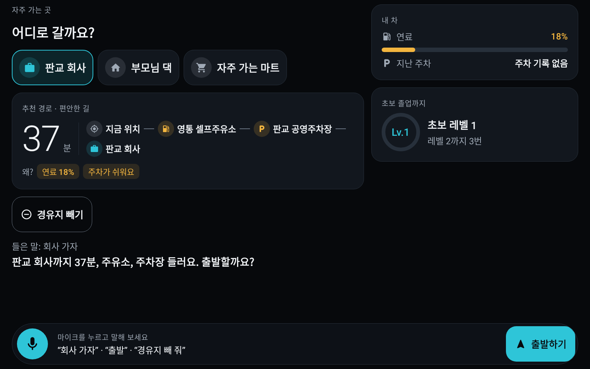
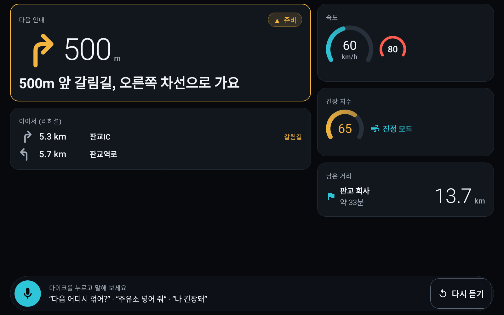
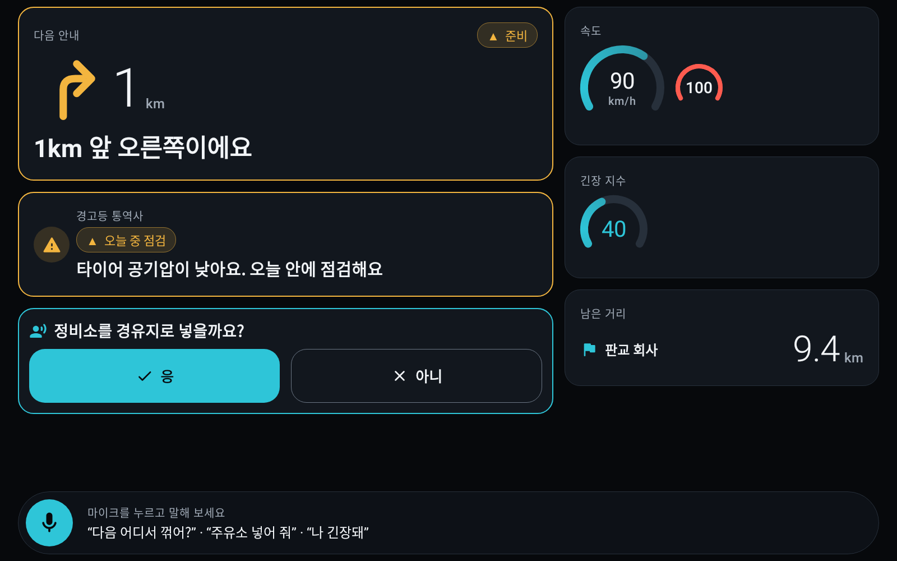
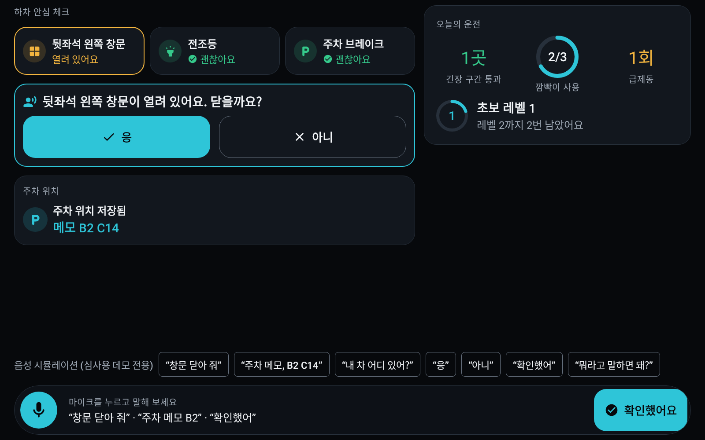
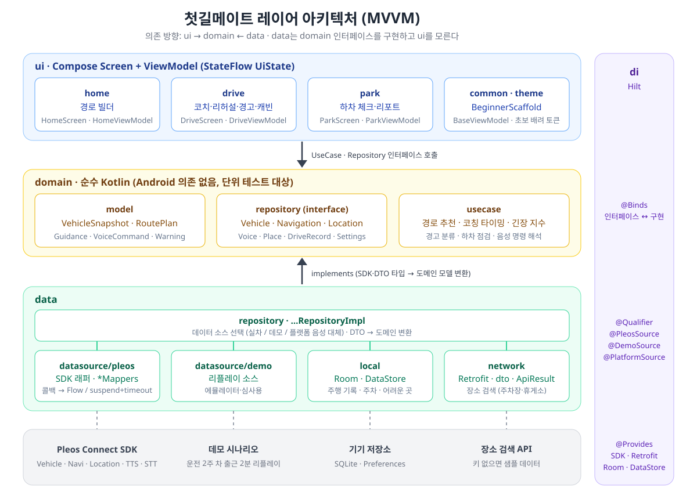

# 첫길메이트 (FirstRoad Mate)

> 숙련자에겐 습관, 초보에겐 매번의 결정.
> 깜빡이·차선 준비·경고등·창문 확인을 차가 먼저 읽고 말로 챙겨 주는, 초보 운전자의 첫 동승자.

Pleos Connect 차량용 Android 앱입니다. 휴대폰이 읽을 수 없는 차량 신호(방향지시등·경고등·창문·기어·공조)로 판단하고, 내비 경유지·공조·창문을 직접 움직입니다. 주행 중에는 음성과 카드 한 장으로만 소통합니다.

| 홈 · 경로 빌더 | 주행 · 다음 행동 카드 |
|---|---|
|  |  |
| **경고등 통역사** | **하차 안심 체크 · 오늘의 운전** |
|  |  |

<sub>1600×1000 렌더링. 1024×768 자동차용 에뮬레이터 실측 화면은 [docs/images/emulator](docs/images/emulator/), 데모 출근길을 화면 터치 없이 음성 명령만으로 진행한 녹화는 [docs/video/demo_voice_only_1024x768.mp4](docs/video/demo_voice_only_1024x768.mp4)(소리 없음)에 있습니다.</sub>

## 디자인

사회초년생이 많이 타는 엔트리 차종(아반떼·캐스퍼·레이·셀토스)의 차량 화면과 같은 디자인 언어로, 원래 차에 있던 기능처럼 보이게 했습니다.

- **콕핏 팔레트:** 검정에 가까운 바탕, 얇은 테두리의 둥근 카드, 차가운 시안 강조색 하나. 강조색은 화면에서 '지금 할 일' 한 곳에만 씁니다.
- **홈 카드 배치:** 왼쪽은 주 화면, 오른쪽은 위젯 열(내 차·초보 졸업까지 / 속도·긴장 지수·남은 거리). 1200dp보다 좁으면 위젯 열을 접습니다.
- **계기판식 숫자와 화살표:** 회전 화살표는 선으로 그리고, 거리·속도는 얇고 큰 숫자로. 카드 테두리 색이 상태(괜찮음 ● / 준비 ▲ / 지금 ■)를 알립니다.
- **손이 기억하는 자리:** 모든 화면 맨 아래에 원형 마이크와 그 화면의 주 버튼. 음성 바는 들은 말과 앱의 대답도 보여 줍니다.
- 디자인 토큰: [`ui/theme`](app/src/main/java/com/firstroad/mate/ui/theme), 공통 부품: [`ui/common/Cockpit.kt`](app/src/main/java/com/firstroad/mate/ui/common/Cockpit.kt), [`VoiceDock.kt`](app/src/main/java/com/firstroad/mate/ui/common/VoiceDock.kt)

## 주요 기능

| 시점 | 기능 | 하는 일 |
|---|---|---|
| 출발 전 | 초보 맞춤 경로 빌더 | 편안한 경로에 주유소·주차장·휴게소를 경유지로 추천해 한 번에 경로 생성 |
| 출발 전 | 고속도로 리허설 | 갈림길 수와 첫 갈림길 방향 예습, 주행 화면에 '이어서' 갈림길 2개, 합류·분기 1km 전 차선 준비 안내 |
| 주행 중 | 첫길 코치 | 내 속도 기준 25초(350m) 전 차선 준비 → 깜빡이 확인 → 칭찬, 사용률 기록 |
| 주행 중 | 경고등 통역사 | 경고등을 위험 3단계와 할 일로 안내, 들를 곳을 경유지로 추가 |
| 주행 중 | 카밍 캐빈 | 긴장 구간 전에 공조를 살짝 조절하고, 지나면 원래대로 복원 |
| 도착 후 | 하차 안심 체크 | P단에서 열린 창문 등 문제만 묻고 닫기, 주차 위치·메모 저장, 성장 리포트 |

화면의 모든 버튼을 말로도 할 수 있습니다(음성 명령 17종). "회사 가자" → "판교 회사까지 37분, 주유소 들러요. 출발할까요?" → "응"으로 출발하고, "주유소 넣어 줘", "나중에", "창문 닫아 줘", "확인했어"처럼 말합니다. 막히면 "뭐라고 말하면 돼?"라고 물으면 됩니다.

안내는 짧습니다(주행 중 25자, 그 밖 40자 이내). 회전 > 경고 > 대답 > 질문 > 코칭 > 칭찬 순으로 우선합니다.

## 실행 방법

### APK 설치

심사용 release APK: [`apk/`](apk/)

```bash
adb install apk/<APK 파일명>.apk
```

### 소스에서 빌드

```bash
./gradlew :app:assembleDebug
```

- 출력: `app/build/outputs/apk/debug/app-debug.apk`
- 필요 도구: JDK 21, Android SDK 36 (`local.properties`의 `sdk.dir` 또는 `ANDROID_HOME`)
- Pleos Connect SDK는 `nexus-playground.pleos.ai` Maven 저장소에서 받습니다 (`settings.gradle.kts`).

### VS Code에서 버튼으로 실행

이 폴더를 VS Code로 열면 아래쪽 상태 표시줄에 버튼이 생깁니다(추천 확장 `Task Buttons` 필요). 확장이 없으면 `Ctrl+Shift+B`가 '앱 실행'입니다.

| 버튼 | 하는 일 |
|---|---|
| ▶ 앱 실행 | 에뮬레이터가 꺼져 있으면 켜고, 빌드·설치·실행 |
| ⟳ 데모 처음부터 | 앱 데이터를 지우고 다시 실행 |
| 에뮬레이터 / 에뮬 끄기 | Android Automotive 에뮬레이터 켜기·끄기 |
| 테스트 · 로그 | 단위 테스트 전체 / 실행 중인 앱 로그 |

도구 위치는 [`scripts/env.cmd`](scripts/env.cmd)에서 정합니다(기본 `C:\sdk`, `FRM_SDK` 환경 변수로 바꿀 수 있음). 같은 스크립트를 터미널에서 바로 써도 됩니다: `scripts\run-app.cmd`

### 장소 검색 API 키 (선택)

경유지 후보 검색에 카카오 로컬 REST API를 씁니다. 키가 없으면 샘플 장소로 동작합니다.

```properties
# local.properties (커밋하지 않음)
PLACE_API_KEY=발급받은_REST_API_키
```

## 테스트 환경

| 모드 | 환경 | 동작 |
|---|---|---|
| 실차 | Pleos Connect 기기 · Pleos Connect Emulator v2.1 | Pleos SDK와 AAOS 차량 API로 실제 신호 사용 |
| 데모 | 그 밖의 Android 기기·에뮬레이터 (API 28+) | '운전 2주 차 출근길'을 2분으로 압축해 재생, 화면 위 '데모 모드' 배지 |

- 실행 환경은 자동으로 고릅니다. 마이크가 없는 환경에서는 화면 아래 음성 버튼 칩으로 음성 명령을 대신할 수 있습니다.
- 데모는 출발 브리핑 → 합류 차선 준비·깜빡이 칭찬 → 타이어 경고(휴게소 경유) → 판교IC 분기 → 급제동 → 도착·하차 체크 순으로 진행됩니다.

```bash
./gradlew :app:testDebugUnitTest
```

단위 테스트 47개: 업무 규칙, 데모 시나리오 전체 교차 검증, 음성 흐름, 안내 문장 길이, 화면 렌더링(Robolectric + Roborazzi). Android Automotive 에뮬레이터(API 34, 1024×768)에서 데모 전체를 음성만으로 실행해 확인했습니다.

## 기술 스택

| 구분 | 사용 |
|---|---|
| 언어·UI | Kotlin 2.3, Jetpack Compose, Material 3 |
| 아키텍처 | MVVM, `ui → domain ← data` 레이어 분리, Hilt |
| 비동기·저장 | Coroutines/Flow, Room, DataStore |
| 네트워크 | Retrofit, OkHttp, kotlinx.serialization |
| Pleos Connect SDK | Vehicle 2.3.2 · NaviHelper 3.0.5 · FusedLocation 1.1.3 · TextToSpeech/SpeechToText 3.3.1 |
| AAOS | CarPropertyManager(차속·기어), CarUxRestrictionsManager(주행 제한) |



```
com.firstroad.mate
├── data/     Pleos·데모·음성 데이터 소스, Room, Retrofit, Repository 구현
├── domain/   모델, Repository 인터페이스, 순수 업무 규칙(UseCase)
├── di/       Hilt 모듈
└── ui/       화면(Screen + ViewModel + UiState), 음성 안내
```

- Pleos SDK 호출은 데이터 계층에만 있고, 주행 중 판단은 `DriveTickUseCase` 순수 함수가 맡습니다.
- 차량 제어(창문·공조)는 정차 중 운전자 확인 후에만 하며, 권한이 없으면 "직접 확인해 주세요" 안내로 대체합니다.
- 경고 안내는 차량 취급설명서를 대체하지 않습니다.
